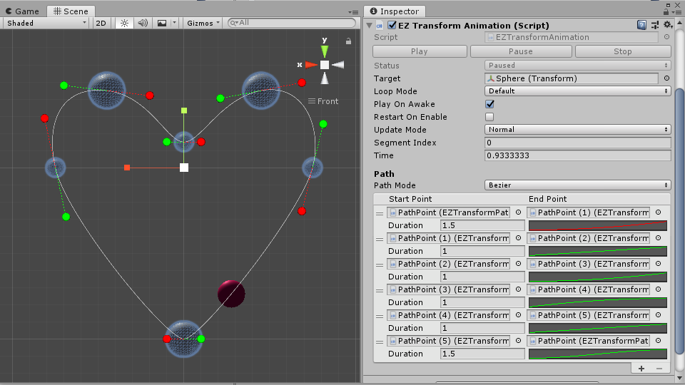
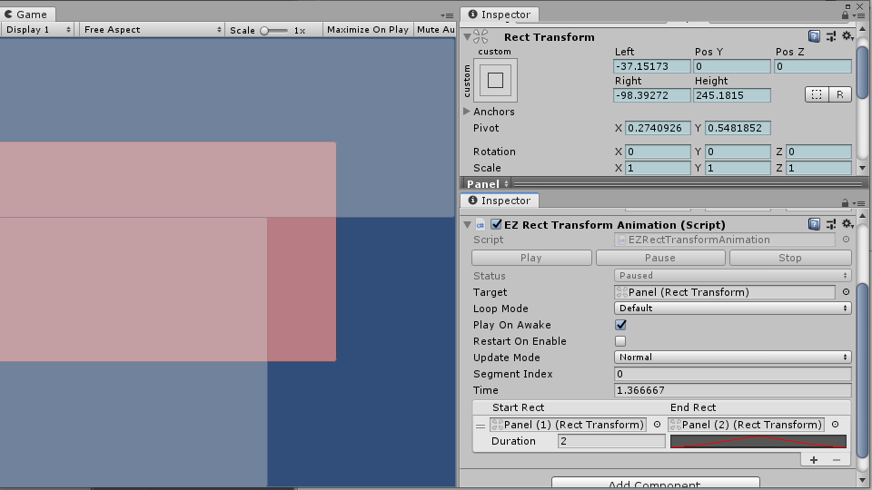
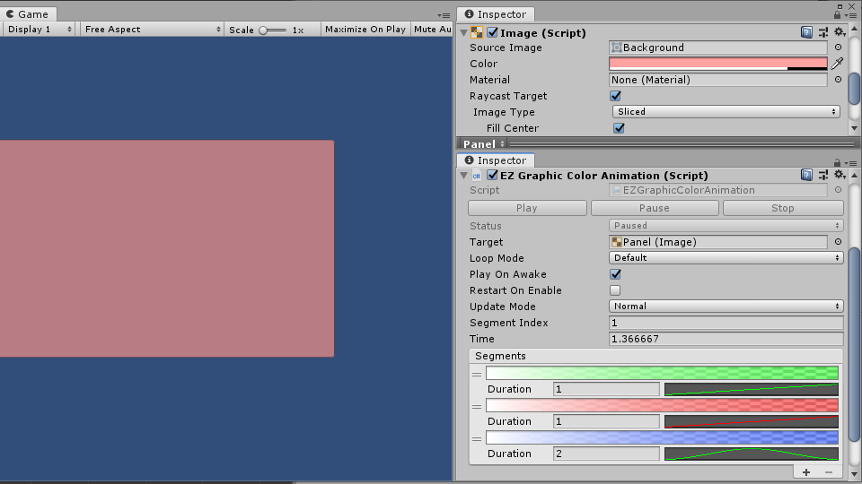
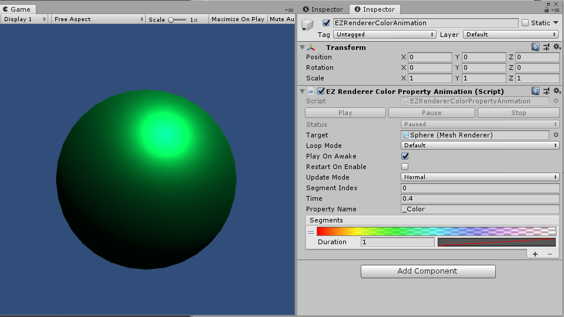

# EZAnimation

[English](README_EN.md)

EZAnimation 是 Unity 的简单无状态插值动画组件。

最低支持 Unity 版本：`2020.3.x`。

依赖 Unity Timeline 和 UGUI 包。

## 组件和功能

EZAnimation 是所有动画组件的基类，负责管理动画时间和播放进度。派生组件通过定义自己的 Segment，并重写 `OnSegmentUpdate` 将计算结果应用到目标对象。

当前包含以下类型的动画组件：

- Transform 和 RectTransform 属性动画
- Graphic 颜色动画
- Renderer Float 和 Color 属性动画
- Timeline Track 和 Clip
- Transform 路径和动画 Segment

## Segment

动画数据由多个 `Segment` 组成，每个 Segment 表示完整动画中的一个片段。

`EZAnimationSegment` 基类包含持续时间和时间曲线。现有动画组件都提供了对应的 CustomEditor，可以在 Inspector 中方便地添加、删除和调整 Segment 列表。

示例：

```csharp
[Serializable]
public class EZColorSegment : EZAnimationSegment
{
    [SerializeField]
    private Gradient m_Gradient = EZAnimationUtility.GradientFadeOut();

    public Gradient gradient
    {
        get { return m_Gradient; }
        set { m_Gradient = value; }
    }

    public Color Evaluate(float time)
    {
        return gradient.Evaluate(time);
    }
}

public class EZGraphicColorAnimation : EZAnimation<Graphic, EZColorSegment>
{
    protected override void OnSegmentUpdate()
    {
        target.color = activeSegment.Evaluate(segmentProcess);
    }
}
```

## Playables

`Runtime/Playables` 提供了通过 Timeline 控制动画时间的附加功能。如果不需要 Timeline 集成，可以移除该目录。

## 示例

示例场景位于 `Samples~/Demo`，可通过 Unity Package Manager 导入 `EZAnimation Demo`。

- EZTransformAnimation



- EZRectTransformAnimation



- EZGraphicColorAnimation



- EZRendererColorPropertyAnimation



## 目录结构

```text
EZAnimation/
├── package.json — Unity Package Manager 包元数据。
├── README.md — 中文说明文档。
├── README_EN.md — 英文说明文档。
├── LICENSE — MIT 许可证。
├── Runtime/ — 运行时动画组件和 Timeline 集成。
│   ├── EZhex1991.EZAnimation.asmdef — 运行时程序集定义。
│   ├── EZAnimation.cs — 动画组件基类。
│   ├── EZAnimationUtility.cs — 动画辅助方法。
│   ├── EZGraphicColorAnimation.cs — Graphic 颜色动画。
│   ├── EZRectTransformAnimation.cs — RectTransform 动画。
│   ├── EZRendererColorPropertyAnimation.cs — Renderer 颜色属性动画。
│   ├── EZRendererFloatPropertyAnimation.cs — Renderer Float 属性动画。
│   ├── EZTransformAnimation.cs — Transform 动画。
│   ├── Playables/ — Timeline Playable、Track 和 Clip。
│   └── Segments/ — 动画 Segment 和 Transform 路径数据。
├── Editor/ — CustomEditor 和编辑器工具。
│   ├── EZhex1991.EZAnimation.Editor.asmdef — 编辑器程序集定义。
│   └── 各动画组件对应的 Inspector 编辑器脚本。
├── Samples~/Demo/ — 示例场景和 Playable 资产。
└── Documentation~/Images/ — README 示例图片。
```

所有源代码均可查看。如果有问题，请在 [GitHub](https://github.com/EZhex1991/EZAnimation) 提交 Issue。
