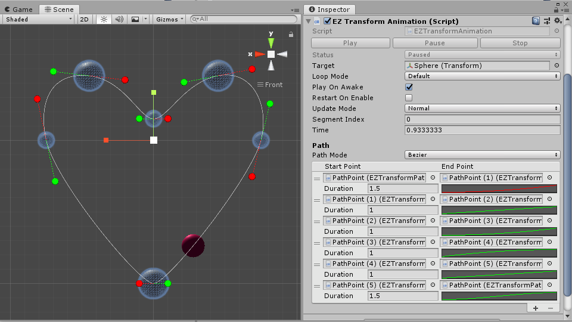
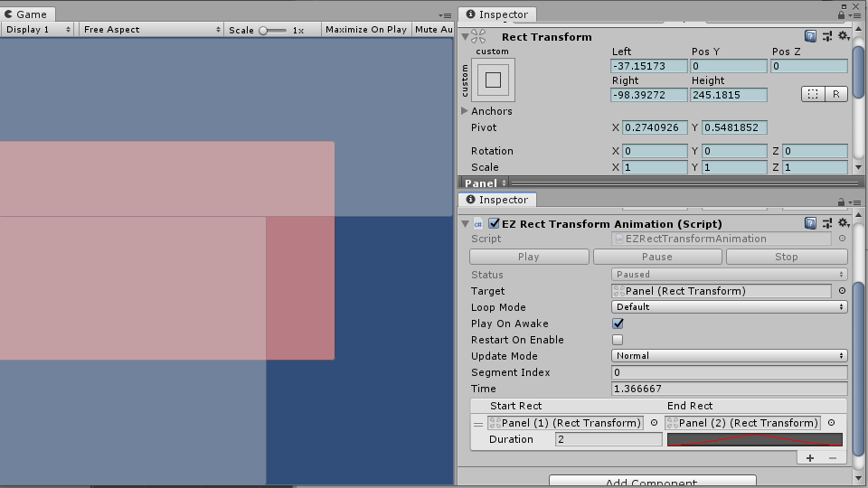
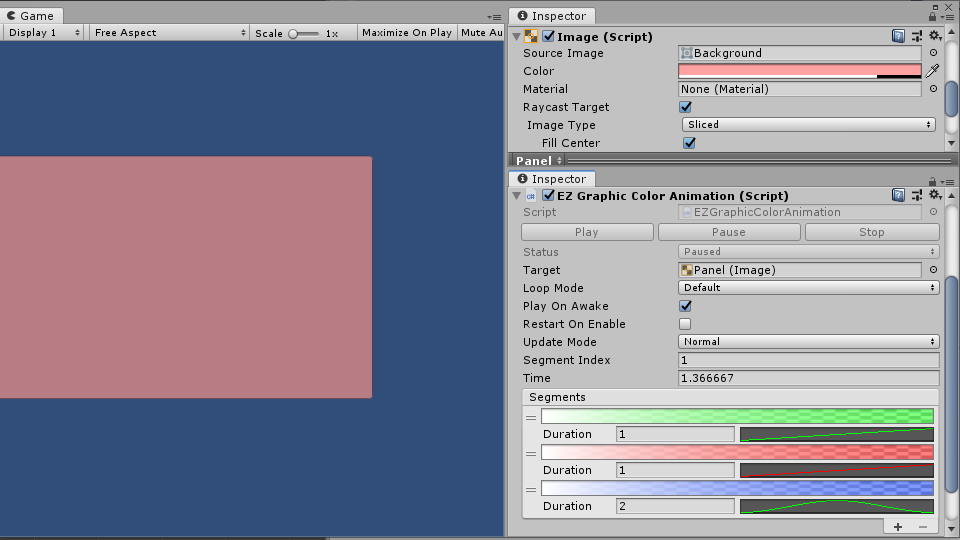
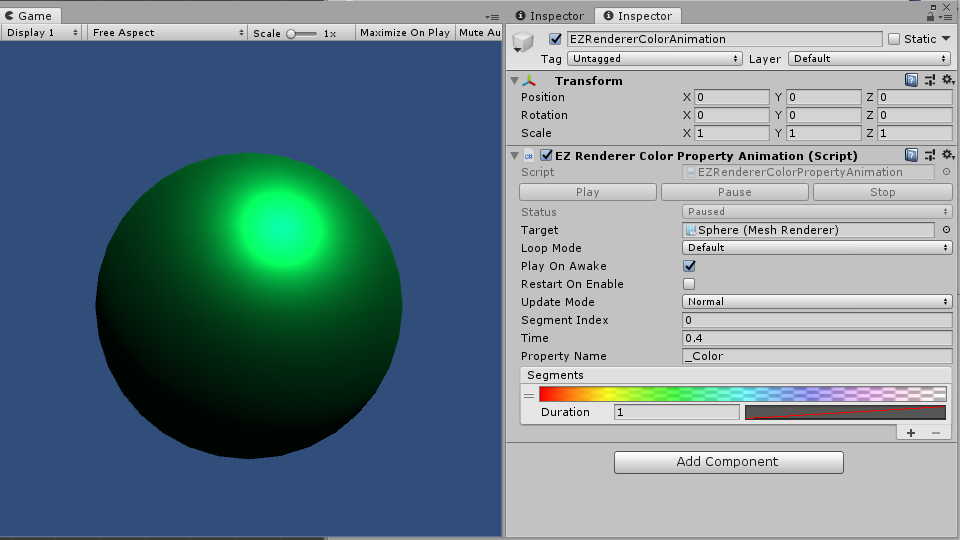

# EZAnimation

[中文](README.md)

EZAnimation provides simple, stateless interpolation animation components for Unity.

Minimum supported Unity version: `2020.3.x`.

This package requires the Unity Timeline and UGUI packages.

## Components and Features

`EZAnimation` is the base class for all animation components. It manages animation time and playback progress. Derived components define their own Segments and override `OnSegmentUpdate` to apply the calculated result to their targets.

The package includes animation components for:

- Transform and RectTransform properties
- Graphic colors
- Renderer Float and Color properties
- Timeline Tracks and Clips
- Transform paths and animation Segments

## Segment

Animation data is made up of multiple `Segment` objects. Each Segment represents a part of the complete animation.

The `EZAnimationSegment` base class contains a duration and a time curve. Existing animation components provide CustomEditors for adding, removing, and reordering Segments in the Inspector.

Example:

```csharp
[Serializable]
public class EZColorSegment : EZAnimationSegment
{
    [SerializeField]
    private Gradient m_Gradient = EZAnimationUtility.GradientFadeOut();

    public Gradient gradient
    {
        get { return m_Gradient; }
        set { m_Gradient = value; }
    }

    public Color Evaluate(float time)
    {
        return gradient.Evaluate(time);
    }
}

public class EZGraphicColorAnimation : EZAnimation<Graphic, EZColorSegment>
{
    protected override void OnSegmentUpdate()
    {
        target.color = activeSegment.Evaluate(segmentProcess);
    }
}
```

## Playables

`Runtime/Playables` provides additional Timeline integration for controlling animation time. If Timeline integration is not needed, this folder can be removed.

## Samples

The sample scene is located in `Samples~/Demo` and can be imported as `EZAnimation Demo` through the Unity Package Manager.

- EZTransformAnimation



- EZRectTransformAnimation



- EZGraphicColorAnimation



- EZRendererColorPropertyAnimation



## Package Structure

```text
EZAnimation/
├── package.json — Unity Package Manager metadata.
├── README.md — Chinese documentation.
├── README_EN.md — English documentation.
├── LICENSE — MIT License.
├── Runtime/ — Runtime animation components and Timeline integration.
│   ├── EZhex1991.EZAnimation.asmdef — Runtime assembly definition.
│   ├── EZAnimation.cs — Base animation component.
│   ├── EZAnimationUtility.cs — Animation helper methods.
│   ├── EZGraphicColorAnimation.cs — Graphic color animation.
│   ├── EZRectTransformAnimation.cs — RectTransform animation.
│   ├── EZRendererColorPropertyAnimation.cs — Renderer color property animation.
│   ├── EZRendererFloatPropertyAnimation.cs — Renderer Float property animation.
│   ├── EZTransformAnimation.cs — Transform animation.
│   ├── Playables/ — Timeline Playables, Tracks, and Clips.
│   └── Segments/ — Animation Segments and Transform path data.
├── Editor/ — Custom Inspectors and editor tools.
│   ├── EZhex1991.EZAnimation.Editor.asmdef — Editor assembly definition.
│   └── Editor scripts for the animation components.
├── Samples~/Demo/ — Demo scene and Playable asset.
└── Documentation~/Images/ — README sample images.
```

All source code is available in the [GitHub repository](https://github.com/EZhex1991/EZAnimation). Please open an Issue if you have any questions.
